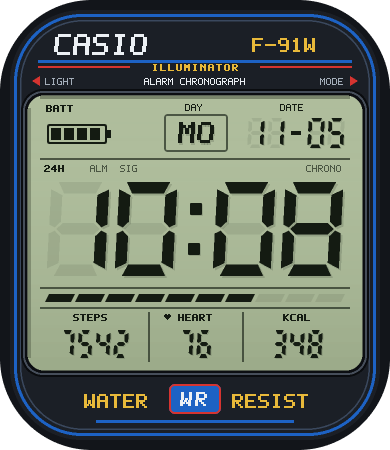
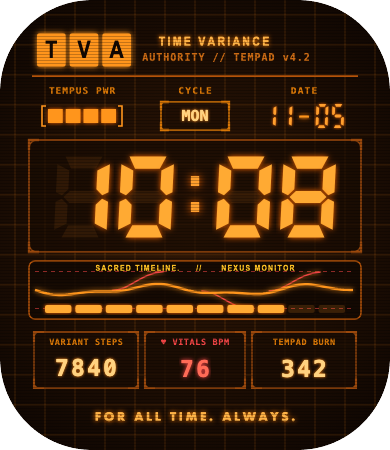

# ⌚ Aolon GTS 3 Watchface Studio & Injector Lab

> **Open-source Visual Watchface Studio, Binary Compiler & Zero-Config MITM Injector for the Aolon GTS 3 AMOLED Smartwatch (`390 × 450`) and UTE / GloryFit RTOS platform.**

[](LICENSE)
[]()
[]()
[-orange.svg)]()

---

## 🌟 Highlights

- 🎨 **Visual Web Studio (`http://localhost:3333`)**: Drag-and-drop live watchface designer in your browser with real-time AMOLED preview and rounded smartwatch bezel mask.
- ⚡ **Zero External Dependencies**: Both Node.js servers and Python compilers run purely on standard built-in libraries (no `npm install`, no `pip install`).
- ⏱️ **Iconic Ready-to-Flash Presets**:
  - **Casio F-91W / A168W Retro Digital**: Custom 7-segment displays, LCD backlight hue, authentic Casio water-resist header.
  - **Loki TVA "Sacred Timeline"**: CRT phosphor green glow, animated waveform graphics, retro terminal typography.
  - **TVA Miss Minutes**: Official mascot sticker integration with live time and battery indicators.
- 🔄 **Smart MITM Proxy Injector**:
  - Automatically intercepts companion app watchface downloads.
  - Dynamically adopts the target watchface ID and recalculates payload CRC32 on-the-fly.
  - No Bluetooth sniffing or device firmware flashing required.
- 📱 **Fast Push (30 Seconds)**: Change 1 Wi-Fi proxy setting on your phone, tap Download in the Aolon app, and your custom design is live on your wrist.

---

## 📸 Previews

| Casio F-91W Retro Digital | Loki TVA Sacred Timeline | TVA Miss Minutes Edition |
| :---: | :---: | :---: |
|  |  |  |

---

## 🚀 Quick Start Guide

### 1. Requirements
- A computer (**macOS, Windows, or Linux**) with:
  - **Node.js** (v18 or newer)
  - **Python 3** (v3.8 or newer)
- Smartphone (iPhone or Android) with the **Aolon** (or **GloryFit**) app paired to your smartwatch.
- Both your computer and phone connected to the **same Wi-Fi network** (or phone connected to computer hotspot).

### 2. Run the Toolkit
Clone the repository and run:
```bash
git clone https://github.com/fayrnaldy/UTE-custom-watchface-studio.git
cd UTE-custom-watchface-studio
npm start
```
The terminal will display your auto-detected local IP and running services:
```text
============================================================
  ⌚ Aolon GTS3 Watchface Studio & Injector is RUNNING!
============================================================
  🎨 Web Studio : http://localhost:3333
  🛡️ Proxy Port : 8888
  🌐 Your IP    : 192.168.1.15  (Configure this on your Phone)
============================================================
```

### 3. Design in Web Studio
1. Open `http://localhost:3333` in your browser.
2. Select a preset (e.g., `Casio Retro Digital` or `Loki TVA`) or design from scratch.
3. Customize widget positions, fonts, colors, and stickers.
4. Click **`💾 Simpan Proyek`**, then click **`⚡ Compile & Pasang ke Proxy`**.

### 4. Flash to Watch via Phone (30 Seconds)
1. **Phone Wi-Fi Proxy Setup**:
   - **iOS**: Settings > Wi-Fi > tap `(i)` on your connected Wi-Fi > **Configure Proxy** > **Manual** > enter the Server IP and Port `8888`.
   - **Android**: Settings > Wi-Fi > tap gear/info on Wi-Fi > **Proxy** > **Manual** > enter Server IP and Port `8888`.
2. **Download CA Certificate (First time only)**:
   - Open Safari/Chrome on phone and browse to `http://<YOUR_IP>:8888/ca.crt`.
   - Install the certificate and enable Full Trust (iOS: *Settings > General > About > Certificate Trust Settings*).
3. **Trigger Sync**:
   - Open the **Aolon** app > **Dial Center / Market**.
   - Pick any free watchface you haven't downloaded yet, and tap **Download / Sync**.
   - The proxy intercepts the request, swaps it with your custom compiled watchface, and syncs it to the watch!
4. **Done!** Turn off the proxy setting on your phone when complete.

---

## 🔬 Reverse Engineering & Technical Architecture

### 1. The Watchface File Container (`WF` v2)
Aolon GTS 3 uses the **UTE (YouCheng / `com.yc.*`) RTOS** firmware architecture. Watchface `.bin` files follow a strict binary layout:

```text
+-----------------------------------------------------------+
| 24-byte Outer Container Header                            |
| - uint32_t: Watchface ID (e.g. 1770888829)               |
| - uint32_t: Payload Length (excluding 24-byte header)    |
| - uint32_t: CRC32 checksum (calculated over Payload)     |
| - uint16_t: Display Width (390)                          |
| - uint16_t: Display Height (450)                         |
| - 8 bytes : Feature flags & padding                      |
+-----------------------------------------------------------+
| Payload: 'WF' Header ('WF\x0c\x04\x01' + BCD version)     |
| - uint32_t: Sub-payload length                           |
| - uint32_t: Offset to Asset Table                        |
| - Section entries (Coordinates, widget bindings, IDs)    |
+-----------------------------------------------------------+
| Asset Table ('PA' Format Bitmaps)                         |
| - Magic: 'PA'                                             |
| - Format: 0x0200 (ARGB8565 Scanline Delta RLE)           |
| - Compressed scanline rows with 16-bit signed offsets     |
+-----------------------------------------------------------+
```

### 2. The `PA` (fmt 0x0200) Bitmap Codec
Unlike standard PNG or uncompressed RAW bitmaps, UTE uses an optimized scanline delta codec designed for low-memory microcontrollers:
- Color format is **RGB565** (16-bit) packed alongside an **8-bit Alpha mask**.
- Transparent margins are skipped via signed row offsets, minimizing flash memory footprint.
- Fully implemented from scratch in pure Python inside [`ute_wf.py`](ute_wf.py).

---

## 🧭 Multi-Smartwatch Compatibility Matrix

A very common question: *"Does this work on other budget smartwatches?"*

Here is the breakdown by platform and chipset ecosystem:

| Platform / Ecosystem | Example Companion Apps | Popular Brands / Models | Tool Compatibility |
| :--- | :--- | :--- | :--- |
| **UTE / YouCheng** | **Aolon**, GloryFit, Kospet Fit | Aolon GTS 3, Kospet, Zeblaze, Mibro | ✅ **Directly Compatible** (adjust resolution if not 390x450) |
| **MoYoung / Da Fit** | Da Fit, Pubu | Colmi (P8, C60), Olike, Fire-Boltt | ⚠️ **Format Different** (Uses Da Fit Type-C `.bin` / DaFup tool) |
| **FitCloudPro / TopStep** | FitCloudPro | Kinyo, Lemfo, Ultra clones | ⚠️ **Format Different** (Uses TBUI binary format) |
| **JieLi / RDFit** | RDFit, Wearfit Pro | HW/HK clone series, Microwear | ⚠️ **Format Different** (Uses JL AC701x packer) |
| **Zepp OS (Amazfit)** | Zepp | Amazfit GTR/GTS/Bip, Cheetah | ℹ️ **Official SDK** (Uses JavaScript Zepp OS SDK) |
| **Wear OS** | Galaxy Wearable, Wear OS | Galaxy Watch 4/5/6, Pixel Watch | ℹ️ **Official Studio** (Uses Samsung Watch Face Studio) |

> 💡 **Tip**: Check which companion app your smartwatch uses in its instruction manual. If your watch uses **GloryFit** or **Aolon**, it belongs to the UTE family and can use this tool!

---

## 📂 Project Structure

```text
aolon-gts3-watchface/
├── README.md               # Documentation & Guide
├── TUTORIAL_DAN_GUIDE.md   # Panduan Lengkap Bahasa Indonesia
├── LICENSE                 # MIT License
├── package.json            # Node.js workspace config
├── run_all.mjs             # One-command dual launcher
├── proxy.mjs               # MITM HTTPS Proxy Interceptor
├── studio.mjs              # Local API backend & project storage
├── studio.html             # Web Studio drag-and-drop designer UI
├── ute_wf.py               # Pure-Python WF v2 & PA codec library
├── build_casio_retro.py    # Casio F-91W generator reference script
├── stock_mask.png          # Accurate GTS3 AMOLED bezel mask
├── assets/                 # Graphics (Miss Minutes, stickers)
└── projects/               # Saved watchface project files (.json)
```

---

## ⚖️ Disclaimer

This software is developed strictly for educational, personal customization, and reverse-engineering research purposes. All trademarks, logos, and brand names (Aolon, Casio, Marvel/Loki) are the property of their respective owners. No official endorsement is implied. Use at your own risk.
